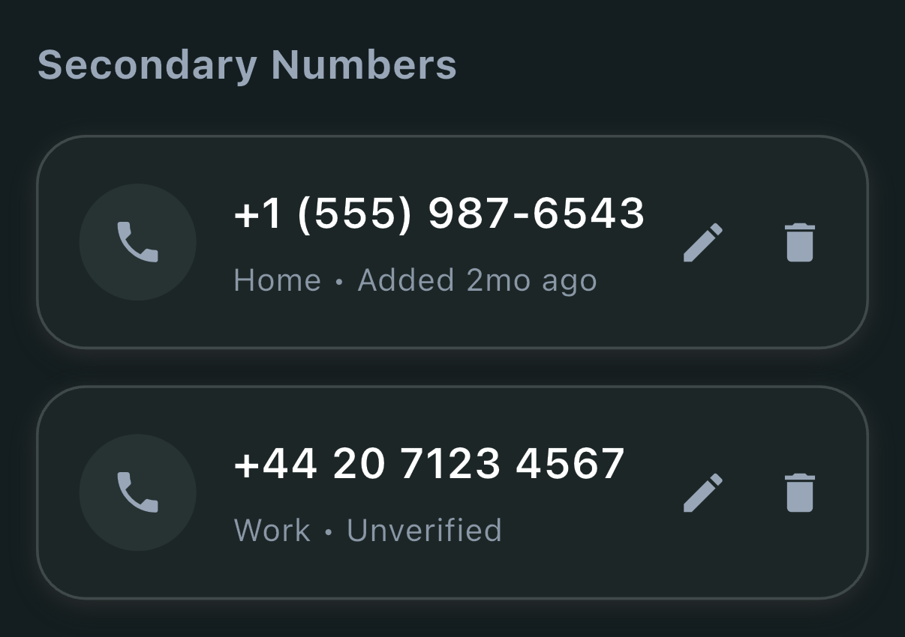
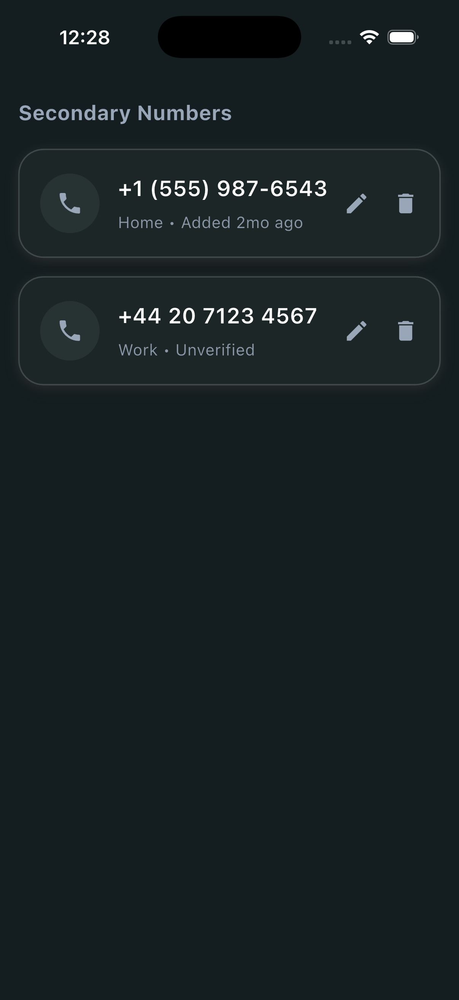

# Layout Design 02 - Flutter Practice Project

A Flutter practice project designed according to instructor specifications using **`Icon`**, **`Row`**, **`Column`**, and **`Container`**.

## 📱 Output Screen



### Full Device View (iOS Simulator)

<p align="center">
  
</p>

## 📋 Student Information

- **Name:** Nazmul Hasan Shipon
- **Roll Number:** `22CSE013`
- **Registration:** `110-013-22`
- **District:** Barishal
- **GitHub Repository:** [iamnazmulhasan/layout-design-02](https://github.com/iamnazmulhasan/layout-design-02)

## 🛠️ Implementation Details

The screen replicates the dark mode Secondary Numbers settings cards using the required widgets:

1. **`Icon`**:
   - `Icons.phone`: Phone handset icon positioned within a dark circular avatar container.
   - `Icons.edit`: Edit pencil action icon for modifying the phone entry.
   - `Icons.delete`: Trash can action icon for removing the phone entry.

2. **`Row`**:
   - Card content layout horizontally distributing:
     - The circular phone badge container.
     - The primary details (`Column` with phone number & status subtitle).
     - The action buttons (`Row` with edit and delete icons).
   - Horizontal spacing between the edit and delete icons.

3. **`Column`**:
   - Main page layout organizing the section header (`Secondary Numbers`) and the list of number cards.
   - Inside each card, vertically stacking the phone number in bold text and the metadata status subtitle (`Home • Added 2mo ago` / `Work • Unverified`).

4. **`Container`**:
   - **Outer Card Container**:
     - Background color: Dark graphite teal (`#1C2627`)
     - Rounded corners: `BorderRadius.circular(22)`
     - Outline border: `Border.all(color: Colors.white16, width: 1.2)`
     - Soft bottom glow reflection effect using dual `BoxShadow` with light elevation.
     - Internal padding: `EdgeInsets.symmetric(horizontal: 18, vertical: 20)`
   - **Icon Badge Container**:
     - Circular shape (`BoxShape.circle`) with `#273233` dark surface.

## 🚀 How to Run

Ensure Flutter is installed and configured on your system.

```bash
# Clone the repository
git clone https://github.com/iamnazmulhasan/layout-design-02.git
cd layout-design-02

# Get dependencies
flutter pub get

# Run on iOS simulator
flutter run -d ios

# Run on Android emulator / device
flutter run -d android
```

## 📸 Submission Screenshot

- **File Name:** `Nazmul_Hasan_22CSE013_Layout_Design_02.png`
